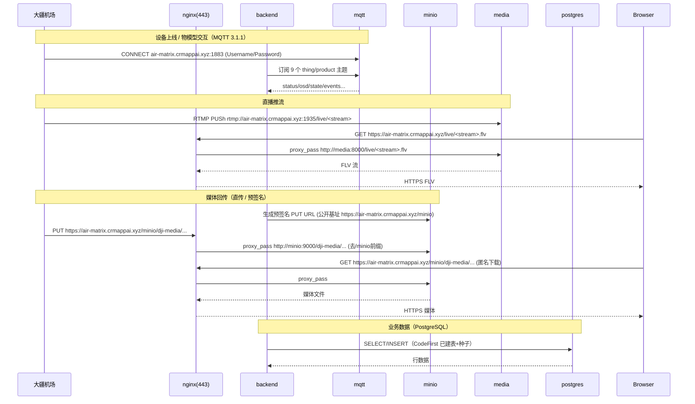
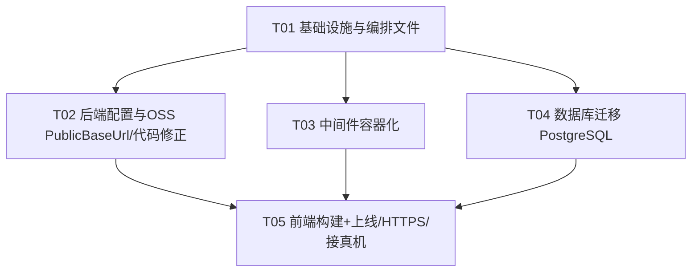

# 无人机智控系统 air-matrix · 线上生产部署架构设计（v2 · 含三项决策）

> 作者：架构师 高见远（software-architect）
> 域名：**air-matrix.crmappai.xyz**
> 适用范围：大疆机场/飞机（Dock-to-Cloud，MQTT 物模型）+ 云服务器 Linux 生产部署
> 配套图：`docs/architecture.mmd`（部署拓扑 + 关键请求链路）、`docs/task-graph.mmd`（任务依赖）
> v2 变更：① MinIO 定为 **方案A**（nginx `/minio` 反代 + 代码新增 `PublicBaseUrl`）；② MQTT 保留 **aedes 加固**；③ 数据库 **改迁 PostgreSQL**（原 SQLite 暂留方案作废）。

---

## 0. 设计前提（已基于代码事实确认）

| 项 | 事实（来自代码探查） |
|---|---|
| 前端 | `dji_vue` Vue3 + Vite；`BASE_PATH='/'` → 所有 API 走同源相对路径（`/api`、`/kapi`、`/hubs`、`/net`、`/[Uu]pload`）；生产 `npm run build` → `dist/` |
| 后端 | `dji_server` .NET 10 + Furion/Admin.NET + **SqlSugar**（当前 `DbType=Sqlite`，两库 `dji.admin.db`/`dji.log.db`）+ SQLite(CodeFirst)；现有 `Dockerfile` 仅运行时阶段（无 build/publish），监听 `http://0.0.0.0:5005` |
| 配置 | `Dji.Application/Configuration/`（App/Dji/Upload/JWT/Database.json），**不入库**；脱敏模板在 `docs/config-template/` |
| 配置扫描 | `appsettings.json` → `ConfigurationScanDirectories: ["Configuration",""]`，即运行目录下的 `Configuration/` 被 Furion 自动合并 |
| OSS 封装 | `Dji.Application/Service/Common/DjiStorageService.cs` 是**对象存储 ↔ 大疆协议**的唯一映射层：`BuildFileUrl()`（预览/下载公开地址）、`BuildStorageConfig()`（下发给机场的 endpoint/凭证）、`BuildDownloadUrlAsync()`、`ExtractObjectKey()`、`ComputeFileDigestAsync()`；调用方（`DjiMediaRepository`/`DjiLogRepository`/`MqMediaService`/`DjiLogService`/`MqFlightAreaService`/`DjiOps.DjiFlightAreaService`）均只调用这些方法，不直接拼 URL |
| OSS 选项 | `Dji.Core/Option/UploadOptions.cs` 的 `OSSProviderOptions : OSSOptions`（OnceMi.AspNetCore.OSS），当前**无** `PublicBaseUrl` 字段 |
| 服务 | `services/mqtt-broker.js`（aedes:1883，演示放行任意凭证）；`services/media-server.js`（node-media-server：RTMP 1935 + HTTP-FLV/HLS 8000，HLS 切片目录，依赖 ffmpeg） |
| 硬编码坑 | `Dji.Core/SeedData/SysMenuSeedData.cs:257` `OutLink="http://localhost:5005"`（Swagger iframe）→ 线上必须改 `https://air-matrix.crmappai.xyz` 并重编 |
| MinIO | 本地桶 `dji-media` 匿名下载、上传账号 `djicloud`；`Upload.json` 的 `OSSProvider` 走 Minio |
| 密钥 | `App.json`→`Cryptogram`(SM2 公私钥)、`JWT.json`→`IssuerSigningKey`、Dji(AppKey/License) 均**不入库** |

---

## Part A · 部署架构设计

### A.1 实现思路（技术难点与选型）

**核心难点**
1. 大疆机场通过**公网 MQTT(1883)** 与 **RTMP(1935)** 直连云端，地址必须是机场侧可达的公网域名，且不能用 `localhost`。
2. 浏览器页面是 **HTTPS** 时，flv/hls 拉流与媒体回传也必须 HTTPS（避免混合内容拦截）→ 流媒体与 MinIO 经 nginx 反代到 https。
3. **数据库从 SQLite 迁 PostgreSQL**：需改 SqlSugar `DbType` + 连接串 + 引入 Npgsql，并排查 CodeFirst 在 SQLite→PG 的类型/建库差异（详见 A.7#4b）。
4. **MinIO 公开基址与内网 Endpoint 分离**：机场直传/浏览器预览必须用公网 HTTPS 地址（`https://air-matrix.crmappai.xyz/minio`），而后端 SDK 服务端操作走内网 `air-matrix-minio:9000` → 需给 OSS 封装层增加 `PublicBaseUrl`，否则会把内网地址暴露给前端/机场。
5. 敏感配置（SM2 私钥 / JWT 签名 / DJI License / MinIO 口令）禁止入库，经宿主机绑定卷 + `.env` 注入。

**选型（最小改动、贴合既有栈）**
- 编排：**Docker Compose**（单宿主机一站式）。
- 反代/TLS 终止/静态托管：**nginx:1.27-alpine** + **certbot/certbot**（Let's Encrypt，自动续期）。
- 后端镜像：`mcr.microsoft.com/dotnet/sdk:10.0`（构建）→ `mcr.microsoft.com/dotnet/aspnet:10.0`（运行），**多阶段 publish**。
- 数据库：**PostgreSQL 16**（compose 内 `air-matrix-postgres` 容器，挂卷；若用户改云 RDS 只需换连接串并删该服务）。
- MQTT：保留 **aedes**（容器化，最小改动），**加固鉴权**（env 校验账号口令）+ 安全组按机场出网 IP 白名单（见 A.9）。
- 流媒体：保留 **node-media-server**（容器化），镜像内置 **ffmpeg**（HLS 必需）。
- 对象存储：**MinIO** 自建容器，对外经 nginx `/minio` path-style 反代（9000 不映射公网）。
- 架构模式：反向代理网关（nginx 唯一公网入口）+ 内网服务网格（Docker 网络，backend/media/minio/postgres 仅内网互通）。

### A.2 整体部署架构图（组件 + 网络流向）

```mermaid
flowchart TB
  subgraph Internet[公网 / 互联网]
    Dock[大疆机场 / 飞机 DJI Dock]
    Browser[浏览器 · 终端用户]
  end

  subgraph Host[云服务器 Linux · Docker Compose 网络 air-net]
    NW[nginx :80/:443<br/>HTTPS终止 + 静态dist + 反代]
    BE[backend dji_server :5005<br/>仅内网]
    MQ[mqtt aedes :1883<br/>公网映射]
    MED[media node-media-server<br/>:1935 RTMP公网 / :8000 内网]
    MINIO[minio :9000/:9001<br/>仅内网]
    PG[postgres :5432<br/>仅内网]
    INIT[minio-init mc / pg-init sql]
    CERT[certbot<br/>Let's Encrypt]
  end

  Dock -->|MQTT air-matrix.crmappai.xyz:1883| MQ
  Dock -->|RTMP 推流 rtmp://air-matrix.crmappai.xyz:1935/live| MED
  Dock -->|HTTPS 直传媒体/下载KMZ| NW
  Browser -->|HTTPS 443| NW

  NW -->|/api /kapi /hubs /net /[Uu]pload| BE
  NW -->|/live HTTP-FLV/HLS| MED
  NW -->|/minio S3(path-style)| MINIO
  BE -->|MQTT 内网| MQ
  BE -->|OSS 内网 air-matrix-minio:9000| MINIO
  BE -->|SQL 内网 :5432| PG
  BE --> PG
  INIT -.建 dji-media 桶/匿名读/账号.-> MINIO
  INIT -.建 dji_admin/dji_log 库.-> PG
  CERT -.签发/续期(air-matrix.crmappai.xyz).-> NW
```

**关键流向说明**
- 机场：MQTT→`air-matrix.crmappai.xyz:1883`（公网）→ mqtt 容器；RTMP 推流→`rtmp://air-matrix.crmappai.xyz:1935/live`；媒体直传/下载→`https://air-matrix.crmappai.xyz/minio/...`（经 nginx）。
- 浏览器：所有流量→`https://air-matrix.crmappai.xyz`；前端静态由 nginx 直接托管 `dist/`；API 同源反代到 backend；flv/hls 经 `/live` 反代到 media；媒体预览经 `/minio` 反代到 MinIO。
- 后端：经 Docker 内网访问 mqtt/minio(9000)/postgres(5432)；自身 5005 **不对外发布**；媒体相关公开地址统一由 `DjiStorageService` 用 `PublicBaseUrl` 拼出，绝不暴露内网 `air-matrix-minio:9000`。

### A.3 关键请求链路（时序）



### A.4 服务清单与端口规划表

| 容器名 | 镜像 | 发布端口(宿主机→容器) | 是否公网直暴露 | 挂载卷 | 依赖 | 健康检查 |
|---|---|---|---|---|---|---|
| `air-matrix-nginx` | nginx:1.27-alpine | 80→80, 443→443 | **是**（唯一 HTTP 入口） | `./deploy/nginx:/etc/nginx/conf.d:ro`、`dji_certs:/etc/letsencrypt`、`dji_www:/var/www/certbot`、`dji_dist:/usr/share/nginx/html:ro` | backend,media,minio,postgres,mqtt(healthy) | `wget -qO- http://localhost/ \| grep -q ...` 或 TCP 80 |
| `air-matrix-backend` | 自建(.NET10 多阶段) | **不发布**（内网 5005） | 否 | `../deploy/config:/app/Configuration:ro` | mqtt,minio,postgres(healthy) | `wget -qO- http://localhost:5005/ -T 3` 退出码判断 |
| `air-matrix-mqtt` | 自建(node:20-slim+aedes) | **1883→1883** | **是**（机场必连） | 无（或 `../services:/app:ro`） | 无 | `node -e "require('net').connect(1883,'127.0.0.1')..."` |
| `air-matrix-media` | 自建(node:20-slim+node-media-server+ffmpeg) | **1935→1935**（RTMP 公网）；8000 不发布 | 1935 是 / 8000 否 | `dji_hls:/app/media` | 无 | `node -e "...connect(8000..."` |
| `air-matrix-minio` | minio/minio:RELEASE.2025-07-23 | **不发布**（9000/9001 仅内网，经 nginx `/minio` 反代） | 否 | `dji_minio:/data` | 无 | `wget -qO- http://localhost:9000/minio/health/live` |
| `air-matrix-postgres` | postgres:16-alpine | **不发布**（5432 仅内网） | 否 | `dji_pg:/var/lib/postgresql/data`、`deploy/postgres/init.sql:/docker-entrypoint-initdb.d/init.sql:ro` | 无 | `pg_isready -U dji` |
| `air-matrix-minio-init` | minio/mc | 无 | 否 | `dji_minio:/data` | minio(healthy) | 一次性（建桶/策略/账号后退出） |
| `air-matrix-certbot` | certbot/certbot:latest | 无（run --rm） | 否 | `dji_certs:/etc/letsencrypt`、`dji_www:/var/www/certbot` | nginx | 非长驻（按需 run） |

**公网必须开放（安全组/防火墙）**：`80/tcp`（ACME + 跳转）、`443/tcp`（HTTPS）、`1883/tcp`（MQTT 机场）、`1935/tcp`（RTMP 机场推流）。
**仅内网/反代（不直暴露）**：`5005`（backend）、`8000`（media HTTP-FLV/HLS）、`9000/9001`（MinIO，经 nginx `/minio`）、`5432`（PostgreSQL，经内网）。

### A.5 nginx 反代规则设计

**关键设计**
- 所有 API 同源相对路径 → 统一反代到 `backend:5005`；用正则 `~* ^/(api|kapi|net|hubs|upload)/` 一次性覆盖（含 `/Upload` 大小写）。
- `/hubs`（SignalR）必须处理 `Upgrade`/`Connection` 头做 WebSocket 透传。
- `/live/` → `media:8000`（**保留 `/live` 前缀**，因 node-media-server 的 app 名就是 `live`）。
- `/minio/` → `minio:9000/`（**去掉 `/minio` 前缀**，path-style；Host 透传）。公开基址 `https://air-matrix.crmappai.xyz/minio` 对应 `Upload.json` 的 `PublicBaseUrl`。
- 前端 SPA：`try_files $uri $uri/ /index.html`。
- 80 端口：ACME 挑战目录直出，其余 301 跳 HTTPS。

**`deploy/nginx/default.conf`（关键片段）**

```nginx
# ---------- HTTP: ACME + 跳转 ----------
server {
    listen 80;
    server_name air-matrix.crmappai.xyz;
    location /.well-known/acme-challenge/ { root /var/www/certbot; }
    location / { return 301 https://$host$request_uri; }
}

# ---------- HTTPS ----------
server {
    listen 443 ssl;
    server_name air-matrix.crmappai.xyz;

    ssl_certificate     /etc/letsencrypt/live/air-matrix.crmappai.xyz/fullchain.pem;
    ssl_certificate_key /etc/letsencrypt/live/air-matrix.crmappai.xyz/privkey.pem;
    ssl_protocols TLSv1.2 TLSv1.3;
    add_header Strict-Transport-Security "max-age=31536000" always;
    server_tokens off;

    root /usr/share/nginx/html;
    location / { try_files $uri $uri/ /index.html; }

    # 后端 API（含 SignalR /hubs 的 WebSocket 升级）
    location ~* ^/(api|kapi|net|hubs|upload)/ {
        proxy_pass http://air-matrix-backend:5005;
        proxy_http_version 1.1;
        proxy_set_header Host $host;
        proxy_set_header X-Real-IP $remote_addr;
        proxy_set_header X-Forwarded-For $proxy_add_x_forwarded_for;
        proxy_set_header X-Forwarded-Proto $scheme;
        proxy_set_header Upgrade $http_upgrade;
        proxy_set_header Connection "upgrade";
        proxy_cache_bypass $http_upgrade;
        proxy_read_timeout 3600s;
    }

    # 流媒体 HTTP-FLV / HLS（保留 /live 前缀）
    location /live/ {
        proxy_pass http://air-matrix-media:8000;
        proxy_http_version 1.1;
        proxy_set_header Host $host;
        proxy_set_header X-Real-IP $remote_addr;
        proxy_read_timeout 3600s;
    }

    # MinIO S3（path-style）：去掉 /minio 前缀
    # 后端 Upload.json: Endpoint=air-matrix-minio:9000(内网), PublicBaseUrl=https://air-matrix.crmappai.xyz/minio
    # -> 公开 URL = https://air-matrix.crmappai.xyz/minio/dji-media/... -> 去/minio -> minio:9000/dji-media/...
    location /minio/ {
        proxy_pass http://air-matrix-minio:9000/;
        proxy_http_version 1.1;
        proxy_set_header Host $host;
        proxy_set_header X-Real-IP $remote_addr;
        client_max_body_size 0;
        proxy_read_timeout 3600s;
    }
}
```

> 域名已固定为 **air-matrix.crmappai.xyz**。如需多环境复用，可改回 `${DOMAIN}` 由 `deploy/.env` + `envsubst` 渲染（compose `command: /bin/sh -c "envsubst ... > /etc/nginx/conf.d/default.conf && nginx -g 'daemon off;'"`）。证书路径 `/etc/letsencrypt/live/air-matrix.crmappai.xyz/` 由 certbot 生成。

### A.6 配置文件清单与相对路径

| 文件（相对仓库根） | 作用 | 是否入库 |
|---|---|---|
| `docker-compose.yml` | 全量服务编排（nginx/backend/mqtt/media/minio/minio-init/postgres/certbot） | **是** |
| `dji_server/Dji.Web.Entry/Dockerfile` | .NET10 多阶段 publish | **是**（已存在，改为多阶段） |
| `services/Dockerfile.media` | node-media-server + ffmpeg 镜像 | **是** |
| `services/Dockerfile.mqtt` | aedes 镜像（含鉴权加固） | **是** |
| `deploy/nginx/default.conf` | nginx 反代规则（见 A.5） | **是** |
| `deploy/postgres/init.sql` | 首次启动建 `dji_admin`/`dji_log` 库 + `dji` 角色 | **是**（不含口令，口令走 env） |
| `deploy/.env.example` | 所有变量/域名/密钥占位模板 | **是** |
| `dji_vue/.env.production.example` | 前端生产环境变量模板 | **是** |
| `docs/config-template/*` | 脱敏配置模板（已存在，需同步 PG / PublicBaseUrl） | **是** |
| `deploy/README.md` | 部署步骤（见 A.8） | **是** |
| `deploy/scripts/build-frontend.sh` | 前端 install+build | **是** |
| `deploy/scripts/deploy.sh` | 编排 build/up/证书一键 | **是** |
| `deploy/scripts/migrate-db.sh` | （可选）SQLite→PG 数据迁移辅助 | **是** |
| `deploy/certbot/init-ssl.sh` | 自签占位证书 + certbot 首次申请 + reload | **是** |
| `deploy/minio/init.sh` | mc 建桶/匿名读策略/建 djicloud 账号 | **是**（被 minio-init 调用） |
| `deploy/.env` | 真实密钥/域名（由 example 复制填充） | **否**（gitignore） |
| `deploy/config/App.json` | 真实后端配置（含 SM2/JWT） | **否** |
| `deploy/config/Dji.json` | 真实 DJI/直播/MQTT 配置（公网地址） | **否** |
| `deploy/config/Upload.json` | 真实 MinIO OSS 配置（含 PublicBaseUrl） | **否** |
| `deploy/config/JWT.json` | 真实 JWT 签名 | **否** |
| `deploy/config/Database.json` | 真实 PostgreSQL 连接串 | **否** |
| `dji_vue/.env.production` | 真实生产变量（SM2 公钥） | **否**（已被 `.gitignore` 忽略 `.env.*`） |

**入 git 原则**：所有含真实密钥/域名/IP 的文件不入库；仅保留 `*.example` / `docs/config-template/` 脱敏模板；`deploy/.env` 与 `deploy/config/*` 加入根 `.gitignore`。

### A.7 必须改的代码 / 配置点清单（含路径与改法）

| # | 文件 | 改法 |
|---|---|---|
| 1 | `dji_server/Dji.Core/SeedData/SysMenuSeedData.cs:257` | `OutLink="http://localhost:5005"`→`OutLink="https://air-matrix.crmappai.xyz"`；**重编发布**（多阶段 Dockerfile 覆盖此修复）。 |
| 2 | `dji_server/Dji.Application/Configuration/Dji.json`（及 `docs/config-template/Dji.json`） | `Dji.FileBaseUrl`=`https://air-matrix.crmappai.xyz`；`Dji.Live.RtmpPushBaseUrl`=`rtmp://air-matrix.crmappai.xyz:1935/live`；`Dji.Live.FlvPlayBaseUrl`=`https://air-matrix.crmappai.xyz/live`；`Dji.Live.HlsPlayBaseUrl`=`https://air-matrix.crmappai.xyz/live`；`Dji.NtpServerHost`=`ntp.aliyun.com`；`Mqtt.Server`=`air-matrix-mqtt`（后端容器内内网服务名）、`Mqtt.Port`=`1883`、`Mqtt.Username/Password`=env 注入的账号；**机场侧**填公网 `air-matrix.crmappai.xyz:1883`（安全组放行 1883）；`Dji.AppId/AppKey/AppLicense`=大疆开发者控制台真实值。 |
| 3 | `dji_server/Dji.Application/Configuration/Upload.json` | `OSSProvider.IsEnable=true`、`Provider=Minio`、**`Endpoint=air-matrix-minio:9000`（内网）**、`IsEnableHttps=false`（内网明文）、`Region=us-east-1`、`Bucket=dji-media`、`AccessKey/SecretKey`=MinIO `djicloud` 账号；**新增 `PublicBaseUrl=https://air-matrix.crmappai.xyz/minio`**（对外公开基址，见 #3b）。 |
| 3b | `dji_server/Dji.Core/Option/UploadOptions.cs` + `dji_server/Dji.Application/Service/Common/DjiStorageService.cs` | **OSS 公开基址改造（关键）**：① `OSSProviderOptions` 新增 `public string PublicBaseUrl { get; set; }`（Furion 会自动从 `OSSProvider` 段绑定）；② `DjiStorageService` 三处改读 `PublicBaseUrl`：`BuildFileUrl()` —— 若 `PublicBaseUrl` 非空，直接返回 `$"{PublicBaseUrl.TrimEnd('/')}/{_oss.Bucket}/{key}"`（path-style），否则退回原内网拼接逻辑；`BuildStorageConfig()` 的 `Endpoint` 字段改为 `NormalizeEndpoint(_oss.PublicBaseUrl ?? _oss.Endpoint)`（机场直传地址必须是对外可达的 `/minio`）；`ExtractObjectKey()` 在按 bucket 剥离前，先按 `PublicBaseUrl` 的 AbsolutePath 前缀（如 `minio/`）剥掉，避免把 `/minio/dji-media/key` 误解析。调用方（`DjiMediaRepository`/`DjiLogRepository`/`MqMediaService`/`DjiLogService`/`MqFlightAreaService`/`DjiOps.DjiFlightAreaService`）**无需改动**——它们都走这两个方法。 |
| 4 | `dji_server/Dji.Application/Configuration/Database.json`（及 `docs/config-template/Database.json`） | **【重大变更】** 两个 `ConnectionConfigs` 的 `DbType` 由 `Sqlite` 改为 `PostgreSQL`；连接串改为 Npgsql 格式（见 #4b）。原"相对路径 `DataSource=./db/...`"的 SQLite 改法**作废**（因已迁 PG）。建议**保留两个库**（`dji_admin` 主库 / `dji_log` 日志库），对应现有 `MainConfigId`/`LogConfigId` 两段配置，与 Admin.NET 日志隔离设计一致、改动最小。 |
| 4b | `dji_server/Dji.Core/SqlSugar/SqlSugarSetup.cs` + `Dji.Core/Dji.Core.csproj` + `docker-compose.yml`(postgres) | **PostgreSQL 适配**：① 在引用 SqlSugar 的项目（`Dji.Core`）增加 `<PackageReference Include="Npgsql" Version="8.*" />`（SqlSugar 的 PostgreSQL 提供器依赖它）；② `Database.json` 的 `DbType="PostgreSQL"` + Npgsql 连接串；③ **建库**：PG 要求目标库先存在，SqlSugar `CreateDatabase()` 在连接串指向不存在的库时会连不上——改用 `deploy/postgres/init.sql`（挂 `/docker-entrypoint-initdb.d/`）在首次启动预建 `dji_admin`/`dji_log` 库 + `dji` 角色；④ **CodeFirst 风险点排查**：a) 主键全为雪花ID(long)自赋值、无 DB 自增列 → PG 无 identity 兼容坑（好）；b) 字符串：无 `[SugarColumn(Length=)]` 的字段 PG 映射为 `text`（OK），有 Length 的为 `varchar(n)`（OK），建议上线前用 DiffLog 跑一遍核对；c) `DateTime`→PG `timestamp`（无时区），`CreateTime` 等由代码赋 `DateTime.Now`，需在应用层统一时区（建议 UTC 或服务器时区），避免与 SQLite 行为漂移；d) `Guid`→PG `uuid`（SqlSugar 支持），若实体以 `string` 存 Guid 则仍是 `text`；e) `bool`→`boolean`、`decimal/double`(经纬度)→`numeric`/`double precision`；f) 标识符：已 `EnableUnderLine=true`+`ToUnderLine` → snake_case 全小写，与 PG 折叠规则一致，无坑；需核对是否有手写大写名未走下划线；g) 保留字（`Order`/`User` 等）：建议用 DiffLog 建表核对；h) 分表（`SplitTable`，日志表可能按月分表）：SqlSugar PG 方言支持，需验证分表后缀与索引；i) `SqlServerCodeFirstNvarchar=true`（MoreSettings）仅影响 SqlServer，对 PG 无害。⑤ **MySQL 切换预留**：若用户改 MySQL，仅需 `DbType="MySql"`（或 `"MySqlConnector"`）+ MySQL 连接串 + 增加 `MySqlConnector` 包，其余代码不动（SqlSugar 按 `DbType` 切换方言）。 |
| 5 | `dji_server/Dji.Application/Configuration/App.json` | `Urls` 保持 `http://0.0.0.0:5005`（内网）；`Cryptogram.PublicKey/PrivateKey`=**重新生成**的 SM2 密钥对（私钥严禁入库）。 |
| 6 | `dji_server/Dji.Application/Configuration/JWT.json` | `JWTSettings.IssuerSigningKey`=随机 64 位十六进制串；`ValidIssuer/ValidAudience`=`air-matrix.crmappai.xyz`（或保留 `dji.cloud`）。 |
| 7 | `dji_vue/.env.production`（及 `.example`） | `VITE_SM2_PUBLIC_KEY`=与后端 `Cryptogram.PublicKey` **完全一致**；`VITE_PUBLIC_PATH=/`；`VITE_API_URL=`（空，同源）。 |
| 8 | `dji_server/Dji.Web.Entry/Dockerfile` | 改为 **多阶段**（sdk publish → aspnet），见 A.7 附录。`.dockerignore` 增加 `**/db`、`**/logs`、`Plugins/`、`docs/`、`*.py`、`Dji.Web.Entry/db/`。 |
| 9 | `services/mqtt-broker.js` | **鉴权加固**：`aedes.authenticate` 由"放行任意"改为校验 `process.env.MQTT_USERNAME/PASSWORD`（与 `Dji.json.Mqtt` 一致）；其余保持最小改动。 |
| 10 | `services/media-server.js` | 容器内 `mediaroot` 指向可写卷（如 `/app/media`）；`FFMPEG_PATH` 指向镜像内置 ffmpeg；端口用 env（`RTMP_PORT`/`MEDIA_HTTP_PORT`）。 |

**多阶段 Dockerfile（节选）**

```dockerfile
# ---- build ----
FROM mcr.microsoft.com/dotnet/sdk:10.0 AS build
WORKDIR /src
COPY Dji.Server.sln ./
COPY Dji.Application/*.csproj Dji.Application/
COPY Dji.Core/*.csproj Dji.Core/
COPY Dji.Web.Core/*.csproj Dji.Web.Core/
COPY Dji.Web.Entry/*.csproj Dji.Web.Entry/
RUN dotnet restore Dji.Web.Entry/Dji.Web.Entry.csproj
COPY . .
RUN dotnet publish Dji.Web.Entry/Dji.Web.Entry.csproj -c Release -o /app/publish /p:UseAppHost=false

# ---- runtime ----
FROM mcr.microsoft.com/dotnet/aspnet:10.0 AS final
WORKDIR /app
ENV LANG zh-Hans
RUN sed -i 's/deb.debian.org/mirrors.aliyun.com/' /etc/apt/sources.list \
 && apt-get update && apt-get install -y procps
COPY --from=build /app/publish .
EXPOSE 5005
ENTRYPOINT ["dotnet", "Dji.Web.Entry.dll"]
```

### A.8 部署步骤（顺序，可复跑）

0. **前置（服务器信息）**：云服务器 = **腾讯云**，**公网 IP `1.13.24.81`**，SSH 维护账号 `tan`；在域名控制台把 `air-matrix.crmappai.xyz` 的 **A 记录指向 `1.13.24.81`**；服务器装 Docker Engine + compose 插件；**腾讯云安全组入站放行 `80/443/1883/1935`**（MinIO 9000 / PG 5432 走内网反代/内网，不开放）；SSH(22) 仅对运维来源 IP 开放，勿对公网全开。
1. **拉代码**：`git clone -b develop <repo> /opt/air-matrix && cd /opt/air-matrix`。
2. **准备密钥/配置**：
   - `cp deploy/.env.example deploy/.env`，确认 `DOMAIN=air-matrix.crmappai.xyz`、填 MQTT 账号口令、Postgres(`POSTGRES_USER/PASSWORD` 与 `Database.json` 一致)、MinIO root/djicloud、JWT 签名、DJI 三件套。
   - 生成 SM2 密钥对（openssl 1.1.1+：`openssl ecparam -name SM2 -genkey -noout -out sm2.key` 并导出公钥 hex）→ 填入 `App.json` 与 `.env.production`。
   - `cp docs/config-template/* deploy/config/` 后按 A.7 改 5 个 JSON（重点：Dji 公网地址、**Upload 新增 PublicBaseUrl**、Database 改 PostgreSQL 连接串、JWT 签名）。
3. **前端构建**：`bash deploy/scripts/build-frontend.sh`（内部 `npm ci && npm run build`，产出 `dji_vue/dist/`）。
4. **后端发布**：由 `docker compose build backend` 多阶段完成（无需宿主机装 .NET）。
5. **构建镜像**：`docker compose build`（backend/media/mqtt/minio/postgres/nginx）。
6. **起服务**：`docker compose up -d` → postgres 首次启动执行 `init.sql` 建 `dji_admin`/`dji_log` 库；minio-init 自动建桶+策略+账号；backend 启动后按 `EnableInitTable/Seed` 用 CodeFirst 在 PG 上建表+种子。
7. **HTTPS**：`bash deploy/certbot/init-ssl.sh`（自签占位让 nginx 起 443 → `docker compose run --rm certbot certonly --webroot -w /var/www/certbot -d air-matrix.crmappai.xyz`（或 `certbot --nginx -d air-matrix.crmappai.xyz`）→ reload nginx）。
8. **数据迁移（可选）**：若是**全新环境**跳过（CodeFirst 自动建表+种子）；若需从**已有 SQLite 迁数据**，运行 `bash deploy/scripts/migrate-db.sh`（导出 SQLite 表 → 映射 PG 类型 → 批量插入；或手工用 `pgloader`/`sqlite3`+`COPY`），注意雪花ID/时间字段对齐。
9. **验证**：HTTPS 首页可载；`/kapi` Swagger；外网 `mosquitto_pub -h air-matrix.crmappai.xyz -p 1883` 测试 MQTT；ffmpeg 推 RTMP 后经 `/live/*.flv` 拉流；MinIO 预签名 URL 可上传/匿名下载（经 `/minio`）；PG 连接与表结构核对；最后在 DJI 控制台绑定真机（见 A.10）。

### A.9 安全与风险

- **安全组 / 防火墙（腾讯云，公网 IP `1.13.24.81`，SSH 维护账号 `tan`）**：入站仅放行 `80/tcp`(ACME+跳转)、`443/tcp`(HTTPS)、`1883/tcp`(MQTT 机场)、`1935/tcp`(RTMP 机场推流)；`9000/9001`(MinIO)、`5432`(PostgreSQL)、`5005/8000`(backend/media) 仅内网/反代，不映射公网；SSH `22` 仅对运维来源 IP 开放，禁止对 `0.0.0.0/0` 全开。
- **MQTT 1883 公网 + aedes 旧逻辑放行任意凭证**：① 先按 A.7#9 加固（env 校验账号口令）；② 安全组**按机场出网 IP 白名单**限制 1883（临时公网调试后可收紧）；③ 长期建议迁移 **Mosquitto 2.x / EMQX 5.x**（ACL + 持久化 + TLS），后端仅改 `Mqtt.Server/Port/Username/Password`，协议 3.1.1 兼容无需改码。
- **MinIO 匿名下载范围**：仅对 `dji-media` 桶的 `GetObject` 设为匿名（mc `anonymous set download dji-media`）；**写入必须用预签名 PUT**（不开放匿名写）；控制台 9001 不暴露。
- **密钥不入库**：SM2 私钥、JWT 签名、DJI AppKey/License、MinIO root/djicloud、Postgres 口令全部走 `deploy/.env` + `deploy/config/*`（gitignore）。`.gitignore` 已忽略 `Dji.Application/Configuration/` 与 `.env.*`，需补 `deploy/.env`、`deploy/config/`。
- **PostgreSQL 备份**：放弃 SQLite 文件拷贝；改用 `pg_dump` 定时任务（宿主机 cron 或轻量容器）：`pg_dump -h air-matrix-postgres -U dji -d dji_admin -Fc > /backup/dji_admin_$(date +%F).dump` 与 `dji_log` 同理；恢复用 `pg_restore`。卷 `dji_pg` 也做快照。
- **证书自动续期**：`certbot renew` 配 `--deploy-hook "docker compose exec nginx nginx -s reload"`；宿主机加 hourly cron：`docker compose run --rm certbot renew`。
- **nginx 加固**：`server_tokens off`、HSTS、登录路由限流（`limit_req`）、仅开必要方法。

### A.10 大疆开发者控制台配置要点

1. 登录 <https://developer.dji.com/user/apps/> 创建 App → 拿到 **App ID / App Key / App License**，填入 `Dji.json` 的 `Dji.AppId/AppKey/AppLicense`，重启后端。
2. **机场（DJI Dock）绑定云端（自定义平台）**：
   - MQTT 地址：`air-matrix.crmappai.xyz:1883`
   - App ID / App Key / License：与后端一致
   - NTP：`ntp.aliyun.com`（由 `Dji.NtpServerHost` 下发给机场，偏差 >30s 会拒立即任务）
   - 推流地址：机场侧读云端 config 的 `RtmpPushBaseUrl`（`rtmp://air-matrix.crmappai.xyz:1935/live`）
   - 媒体存储 endpoint：后端 `storage_config_get` 经 `PublicBaseUrl` 下发 `https://air-matrix.crmappai.xyz/minio`（机场直传走此公网 HTTPS 地址）
3. **「服务器地址 / 回调 URL」**：本项目设备接入**主要走 MQTT**；若 DJI 控制台存在 OAuth/Webhook 回调字段，填 `https://air-matrix.crmappai.xyz`（由 nginx 反代到 backend 对应路由）；若无对应后端路由，保持默认即可，不影响 MQTT 主链路。
4. 前端 `.env` 不含 DJI 凭证（已核实前端不读取），**只在后端 `Dji.json` 填一次**。

### A.11 待确认 / 待决策事项（状态）

1. **MinIO 对外方式（已决策 ✅ 方案A）**：nginx `/minio` path-style 反代（零额外公网端口），`Upload.json` 内网 `Endpoint=air-matrix-minio:9000` + 对外 `PublicBaseUrl=https://air-matrix.crmappai.xyz/minio`；MinIO 9000/9001 不映射宿主机。
2. **MQTT（已决策 ✅ 先 aedes 加固）**：保留 aedes，env 校验账号 + 安全组机场 IP 白名单；后续可换 Mosquitto/EMQX（后端仅改 Mqtt 配置）。
3. **数据库（已决策 ✅ 迁 PostgreSQL）**：compose 内 `postgres:16-alpine` 容器（默认）；若用户用云 RDS 只需换连接串并删 postgres 服务。MySQL 仅作为备选（改 DbType + 连接串 + MySqlConnector 包，已预留）。
4. **流媒体**：保留 node-media-server（最小改动），单机够用；后续可换 SRS（更好并发/集群）。
5. **SM2 密钥生成工具**：宿主机 openssl 是否支持 SM2（≥1.1.1）；否则用后端自带生成器或离线工具生成。

### A.12 仍不清楚 / 假设

- MinIO 已定为由 nginx `location /minio/` 反代（公开基址 `/minio`，9000 不映射）；`DjiStorageService` 用 `PublicBaseUrl` 拼公开 URL/下发给机场的 endpoint。
- PostgreSQL 默认按 compose 内 `air-matrix-postgres` 容器设计；`init.sql` 首次启动预建两库；若用户改云 RDS，连接串指向 RDS 即可，DB 迁移任务(T04)相应简化。
- 假设单机规模下 PG 可接受；WAL/备份策略用 `pg_dump` 定时任务。
- 假设宿主机可装 ffmpeg 进 media 镜像、且有 openssl(SM2) 能力。
- `deploy/config` 运行时挂载到 `/app/Configuration`（与 `ConfigurationScanDirectories` 一致）；若实际扫描路径不同，挂载点需相应调整（已留验证点）。

---

## Part B · 任务分解（交付工程师）

### B.1 所需依赖 / 镜像

```
# 宿主机
docker engine + docker compose plugin
openssl (支持 SM2, >=1.1.1) / 或后端自带 SM2 生成器
# 容器镜像（compose 拉取/构建）
mcr.microsoft.com/dotnet/sdk:10.0        # 后端构建阶段
mcr.microsoft.com/dotnet/aspnet:10.0     # 后端运行
node:20-slim                             # mqtt / media 基础镜像
minio/minio:RELEASE.2025-07-23           # 对象存储
minio/mc                                 # 初始化桶/策略/账号
postgres:16-alpine                       # 业务数据库
nginx:1.27-alpine                        # 反代/TLS/静态
certbot/certbot:latest                   # Let's Encrypt
# NuGet（后端）
Npgsql 8.*                               # PostgreSQL ADO（SqlSugar PG 提供器依赖）
```

### B.2 任务清单（按依赖排序，≤5 个）

> 规则：T01 必为基础设施；每个任务 ≥3 个文件；尽量仅依赖 T01。原"T02 中 Database.json 改相对路径"已作废，改为"Database.json 改 PostgreSQL 连接串"并提升为独立迁移任务。

**T01 · 项目基础设施与编排文件** ｜ 优先级 P0 ｜ 依赖：无
- 源文件：`docker-compose.yml`、`dji_server/Dji.Web.Entry/Dockerfile`(多阶段)、`services/Dockerfile.media`、`services/Dockerfile.mqtt`、`deploy/nginx/default.conf`、`deploy/postgres/init.sql`、`deploy/.env.example`、`dji_vue/.env.production.example`、`deploy/README.md`、`deploy/scripts/build-frontend.sh`、`deploy/scripts/deploy.sh`、`deploy/scripts/migrate-db.sh`、`deploy/certbot/init-ssl.sh`、`deploy/minio/init.sh`
- 交付：可用 `docker compose config` 校验的编排骨架（含 postgres/minio/mqtt/media/nginx/backend/certbot）+ 反代配置 + 变量模板 + 部署脚本（含前端 build 脚本）。

**T02 · 后端配置与代码修正（公网地址 + OSS PublicBaseUrl + 敏感密钥 + 硬编码修复）** ｜ 优先级 P0 ｜ 依赖：T01
- 源文件：`deploy/config/App.json`、`deploy/config/Dji.json`、`deploy/config/Upload.json`、`deploy/config/JWT.json`、`docs/config-template/*`(同步脱敏模板)、`dji_server/Dji.Core/SeedData/SysMenuSeedData.cs`(改 localhost 硬编码)、`dji_server/Dji.Core/Option/UploadOptions.cs`(新增 PublicBaseUrl)、`dji_server/Dji.Application/Service/Common/DjiStorageService.cs`(BuildFileUrl/BuildStorageConfig/ExtractObjectKey 改读 PublicBaseUrl)
- 交付：5 个生产配置（Dji 全量公网地址、Upload 内网 Endpoint+PublicBaseUrl、JWT 签名、SM2 新密钥占位）+ OSS 公开基址改造 + SysMenuSeedData 修复并被多阶段构建覆盖。

**T03 · 中间件容器化（MQTT 鉴权加固 / 流媒体 / MinIO 桶）** ｜ 优先级 P1 ｜ 依赖：T01
- 源文件：`services/mqtt-broker.js`(env 校验账号)、`services/media-server.js`(卷路径/ffmpeg env)、`services/Dockerfile.media`、`services/Dockerfile.mqtt`、`deploy/minio/init.sh`、`docker-compose.yml`(mqtt/media/minio/minio-init 服务段)
- 交付：aedes 加固镜像、media+ffmpeg 镜像、MinIO 容器与 `dji-media` 桶（匿名读 + djicloud 账号）初始化。

**T04 · 数据库迁移（PostgreSQL）** ｜ 优先级 P0 ｜ 依赖：T01
- 源文件：`docker-compose.yml`(air-matrix-postgres 服务 + 卷)、`deploy/postgres/init.sql`(建 dji_admin/dji_log 库 + dji 角色)、`dji_server/Dji.Application/Configuration/Database.json`(改 PG 连接串，DbType=PostgreSQL)、`docs/config-template/Database.json`(同步)、`dji_server/Dji.Core/SqlSugar/SqlSugarSetup.cs`(核对 CreateDatabase/建库流程，去掉仅 Sqlite 专属路径依赖)、`dji_server/Dji.Core/Dji.Core.csproj`(加 Npgsql 包)、`deploy/scripts/migrate-db.sh`(可选 SQLite→PG 数据迁移)
- 交付：PG 容器就绪 + 两库预建 + 后端按 `EnableInitTable/Seed` 在 PG 上 CodeFirst 建表与种子；列明并排除 CodeFirst 类型/时区/保留字/分表风险点（A.7#4b）。

**T05 · 前端构建 + 上线部署、HTTPS 与接真机验证** ｜ 优先级 P0 ｜ 依赖：T02,T03,T04
- 源文件：`dji_vue/.env.production`、`dji_vue/dist/`(产出)、`deploy/scripts/build-frontend.sh`、`deploy/.env`(真实密钥)、`deploy/config/*`(真实配置)、`deploy/certbot/`(证书)、安全组/防火墙脚本、`deploy/README.md`(验证 checklist)
- 交付：`docker compose up -d` 全量运行 + certbot 证书 + 端口/防火墙收敛 + HTTPS/MQTT/RTMP/MinIO/PG 验证 + DJI 真机绑定。

### B.3 共享知识（跨任务约定，供工程师遵循）

```
- 后端所有 JSON 配置运行时位于 /app/Configuration（与 ConfigurationScanDirectories 一致），由 deploy/config 绑定挂载（ro）。
- 敏感信息只进 deploy/.env 与 deploy/config/*（均 gitignore）；入库只留 *.example 与 docs/config-template/。
- SM2 公钥必须在 App.json.Cryptogram.PublicKey 与前端 VITE_SM2_PUBLIC_KEY 两处完全一致。
- MinIO：桶名固定 dji-media；后端 Upload.json 内网 Endpoint=air-matrix-minio:9000(IsEnableHttps=false)，对外公开基址 PublicBaseUrl=https://air-matrix.crmappai.xyz/minio（走 443 经 nginx /minio 反代）；9000/9001 不映射宿主机；DjiStorageService 用 PublicBaseUrl 拼 URL/下发给机场的 endpoint，绝不暴露内网地址。
- MQTT 账号口令由 deploy/.env 的 MQTT_USERNAME/MQTT_PASSWORD 注入，aedes 与 Dji.json.Mqtt 两侧必须一致；机场侧填 air-matrix.crmappai.xyz:1883。
- 数据库：PostgreSQL 16，默认 compose 内 air-matrix-postgres(:5432 仅内网)；主库 dji_admin、日志库 dji_log；连接串在 Database.json 的 DbType=PostgreSQL + Npgsql 格式；若改云 RDS 只换连接串删 postgres 服务；MySQL 备选仅改 DbType+连接串+MySqlConnector 包。
- 构建上下文：backend 用 dji_server/ 为 context、dockerfile=Dji.Web.Entry/Dockerfile；前端先宿主机 build 出 dist 再挂进 nginx。
- 所有对外 HTTPS 由 nginx 单点终止；backend/media/minio/postgres 仅内网，端口不映射宿主机（除 1883/1935 为机场必需）。
- 备份：PostgreSQL 用 pg_dump 定时任务（替代原 SQLite 文件拷贝）；MinIO 数据卷 dji_minio 做快照。
```

### B.4 任务依赖图


